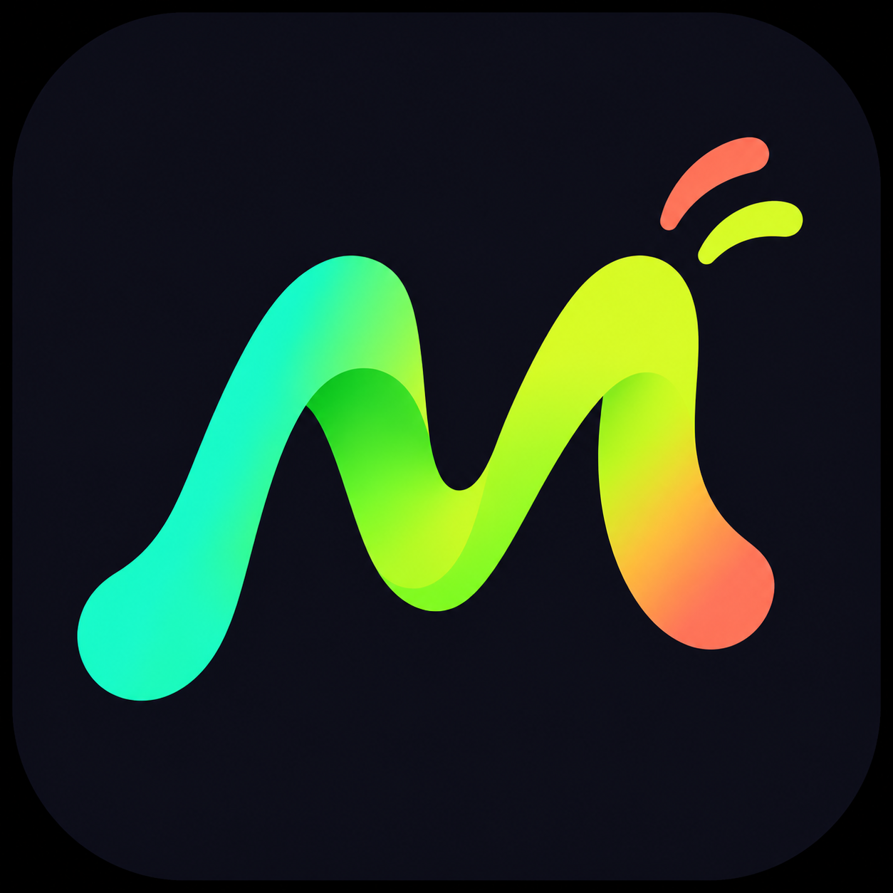

# Müzikçalar

Kendi kendime reklamsız müzik dinleyebilmek için başladığım ufak bir uğraş. Bir şarkı arayayım, sıraya atayım, arka planda çalsın derken işin içine Windows ve Android sürümleri de girdi. Buraya da kaynak kodu dursun diye bıraktım. :D

- YouTube’da şarkı veya sanatçı ara, yazarken gelen önerileri seç, video bağlantısı yapıştır ya da cihazındaki ses dosyalarını çal.
- Çalma sırasını düzenle, beğendiğin parçaları kaydet ve çalma listeleri oluştur.
- Kitaplığını JSON ile Windows ve Android arasında taşı. Uygulamayı yeniden açtığında kaldığın parçaya dön.
- Android’de arka planda dinle. Windows’ta medya tuşlarıyla çalmayı yönet.

## Nasıl çalıştırılır?

**Windows** için Windows 10/11 x64, .NET Framework 4.8 ve YouTube bağlantıları için Node.js 22+ gerekir. Önce mpv ve yt-dlp dosyalarını proje kökündeki `bin/` klasörüne koy. Ardından PowerShell’de `.\Derle.ps1` çalıştırıp oluşan `Muzikcalar.exe` dosyasını aç. [Windows bağımlılıkları ve derleme](docs/GELISTIRME.md#windows)

**Android** için `android/` klasörünü Android Studio’da aç. Java 17 ve Android SDK 36 ile debug sürümünü çalıştırabilirsin. Kendi imzanla APK oluşturmak için derleme notlarına bak. [Android kullanım ve derleme notları](android/OKU.md)

YouTube’dan oynatma internete ve yt-dlp’nin o sırada çalışmasına bağlı. Yerel ses dosyaları çevrimdışı çalar.

[Arama önerileri raporu](docs/arama-onerileri.md) · [Geliştirme ve test komutları](docs/GELISTIRME.md) · [Bileşenler ve lisanslar](docs/BILESENLER.txt)
