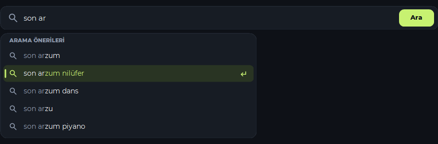

# Arama önerileri

Windows ve Android’de şarkı veya sanatçı adı yazarken arama alanının altında en fazla beş YouTube önerisi görünür. İki karakter yazıp kısa bir ara verince liste açılır. Bir öneri seçildiğinde arama o metinle başlar.

## Arayüz

- **Windows** uygulamasında öneriler, arama alanının soluna hizalanan ve genişliği sınırlanan yuvarlak köşeli bir panelde görünür. Yazılan kısım ile önerinin devamı farklı tonlarda gösterilir. Fareyle üzerine gelinen satır hafifçe aydınlanır. Klavyeyle seçilen satır yeşil bir işaretle vurgulanır. Yukarı ve aşağı oklarla gezinilir, Enter ile arama başlar ve Escape listeyi kapatır.
- **Android** uygulamasında öneriler arama alanına bağlı açılır listede görünür. Bir satıra dokunulduğunda liste ve klavye kapanır, sonuçlar yüklenir.

## İstek akışı

Uygulama yazmaya 250 ms ara verildiğinde uygun arama metnini YouTube önerileri için `suggestqueries.google.com` adresine gönderir. Bağlantı biçimindeki metinler ve tek karakterli sorgular öneri isteği oluşturmaz. Metin değiştiğinde veya arama başlatıldığında önceki öneri isteği iptal edilir. Geç gelen yanıtlar yalnızca hâlâ geçerli sorguya aitse gösterilir.

Öneri isteği üç saniye içinde tamamlanamazsa veya servis yanıt vermezse kullanıcı **Ara** ile yazdığı metni aratabilir. Yanıttaki boş ve yinelenen satırlar elenir, kalan öneriler servis sırasıyla gösterilir.

## Doğrulama

| Ortam | Kontrol | Sonuç |
| --- | --- | --- |
| Windows | Arama ayrıştırma ve iptal, kitaplık, yerel mpv oynatma ve arayüz testleri | Geçti |
| Windows | Öneri panelinin yerleşimi ve ok tuşları, Enter, Escape davranışı | %100, %150 ve %200 ölçeklerde geçti |
| Windows | Canlı `gülşen` sorgusu | Türkçe karakterli beş öneri döndü |
| Android | Yedi JVM testi ve debug lint | Testler geçti. Lint sıfır hata ve 14 uyarı bildirdi |
| Android | API 34 emülatöründe canlı öneri seçimi | Dar dikey ekranda ve büyük yazılı yatay ekranda seçilen metinle arama başladı |
| Android | İmzalı APK doğrulaması | Sertifika önceki APK ile eşleşti |

Android öneri akışı fiziksel telefonda denenmedi. Yerel derleme ve doğrulama komutları [geliştirme kılavuzunda](GELISTIRME.md) yer alıyor.
